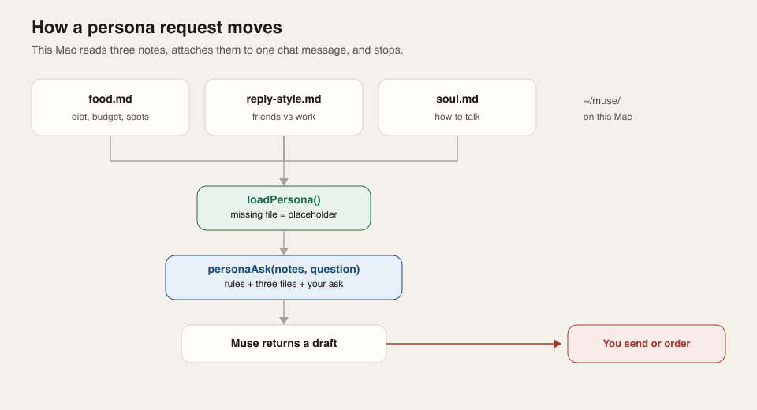
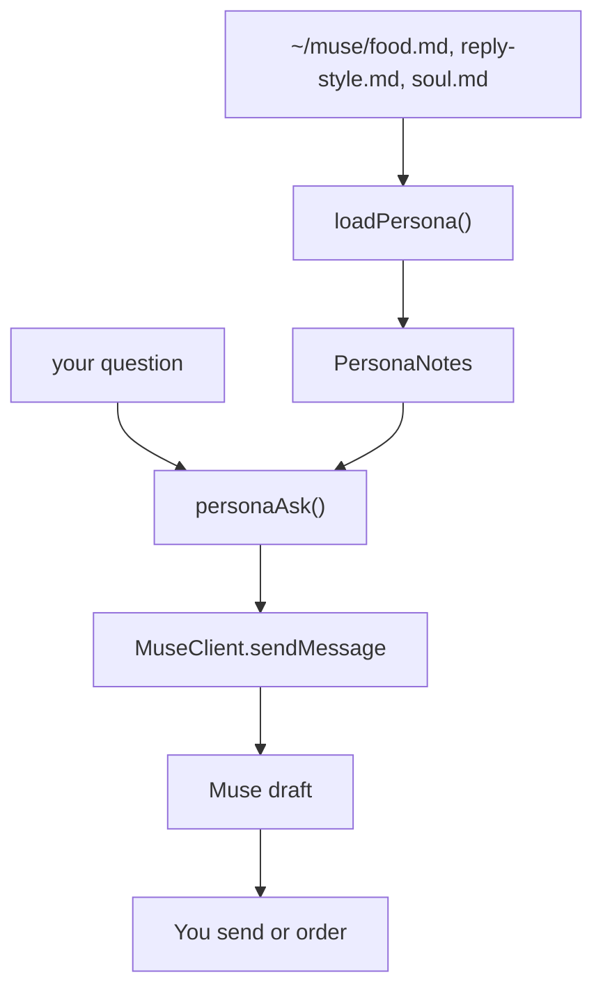
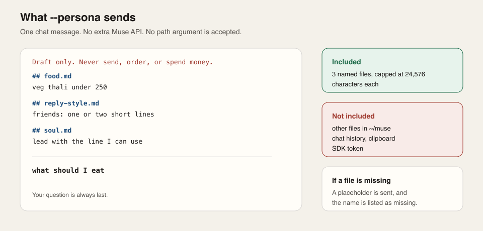
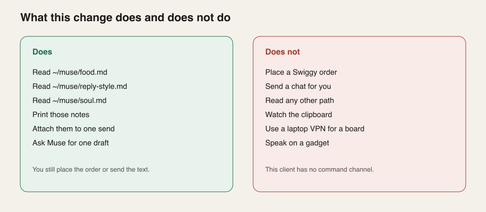

# muse-client

Unofficial TypeScript SDK for chatting with [Muse](https://muse.ai), based on the
[Muse Gadget SDK](https://github.com/facebookincubator/muse-gadget-sdk) protocol.
Supports streaming text chat, VM lookup, token refresh, and macOS Bluetooth pairing.

Requires Node.js 22.18 or later. Pairing supports macOS; chat also runs on Linux.

## Install

```sh
npm install muse-client
```

## Pair with Muse

Pairing requires Xcode Command Line Tools (`xcode-select --install`) and a personal
[SDK token](https://gadgets.muse.ai/settings/sdk-tokens).

From the project directory:

```sh
bun install
bun run cli pair
```

1. Paste your SDK token when prompted and allow Bluetooth access.
2. In the Muse phone app, enable **Settings > Devices > Developer mode**, then
   choose **Add Device**.
3. Select the printed `MuseGadgetXXXXXX` name, confirm, and choose
   **Use current connection** for Wi-Fi.
4. Wait for `Paired successfully`.

The phone must be able to reach `hatch-api.meta.ai` to obtain device credentials.
If pairing fails after selecting a network, check the phone's network or proxy rules.

For pairing from your own application:

```ts
import { pairMacOS } from 'muse-client/pairing';

const credentials = await pairMacOS({
  sdkToken: process.env.MUSE_SDK_TOKEN,
  onProgress: console.log,
});
```

Pairing saves credentials locally. The default directory is
`~/Library/Application Support/MuseGadgetPair/` on macOS and `/var/lib/musegadget/`
on Linux. Use `--credentials <directory>` in the CLI or `directory` in `pairMacOS`
to choose another location. Existing pairings are preserved.

## CLI example

The CLI runs from the repository:

```sh
bun run cli chat                 # Interactive chat; /quit or Ctrl+C to exit
bun run cli vms                  # List Muse VMs
bun run cli check                # Check the connection without sending a message
bun run cli send "Hello Muse"    # Send a message and print its acknowledgement
bun run cli persona              # Print ~/muse notes
bun run cli send --persona "what should I eat"   # Attach those notes, then ask
bun run cli watch --json         # Stream chat events
bun run cli unpair               # Remove local pairing credentials
```

Use `--vm <id>` to choose a VM, `--session <id>` for an existing side chat, and
`--help` for all options.

Before running `unpair`, stop any chat or pairing process. It preserves the device
identity and SDK token. To remove the device association from Muse, use
**Settings > Devices** in the phone app.

## SDK usage

After pairing:

```ts
import { MuseClient } from 'muse-client';
import { loadCredentials, saveCredentials } from 'muse-client/credentials';

const client = await MuseClient.connect({
  credentials: await loadCredentials(),
  onCredentials: saveCredentials,
});

try {
  const events = await client.subscribe();
  const reading = (async () => {
    for await (const event of events) {
      if (event.event === 'delta.text_append') {
        process.stdout.write(String(event.payload.text ?? ''));
      }
    }
  })();
  reading.catch(() => {}); // Handle early rejection while sendMessage is pending.

  const ack = await client.sendMessage('Hello!');
  console.log('Accepted message:', ack.messageId);
  await reading; // Streams until closed or aborted.
} finally {
  client.close();
}
```

- Subscriptions default to the main chat. For an existing side chat, pass the same
  `sessionId` to `subscribe` and `sendMessage`. A new side chat must be created by
  sending its first message before subscribing.
- Events may include activity from other clients in the same session. Message
  completion does not necessarily mean the whole assistant turn has ended.
- Persist refreshed credentials with `onCredentials`. Avoid concurrent processes
  sharing the same credentials. The SDK does not automatically reconnect or resend.

## API

| Import | Exports |
| --- | --- |
| `muse-client` | `MuseClient`, `MuseAccount`, `loadPersona`, `personaAsk` |
| `muse-client/credentials` | `loadCredentials`, `saveCredentials`, `unpair` |
| `muse-client/pairing` | `pairMacOS`, `buildPairingHelper`, `validateSDKToken` |

`MuseClient` provides `connect`, `sendMessage`, `subscribe`, and `close`.
`MuseAccount` provides `listVMs` and `refresh`.

Audio, attachments, history listing, and independent account login are not supported.
The SDK does not expose local shell commands or device controls to Muse.

## Persona notes

`--persona` attaches `~/muse/food.md`, `reply-style.md`, and `soul.md` to one chat message. Muse drafts. You still send the text or place the order. This does not add a gadget command channel.





`personaAsk` builds one string, in this order: the draft rule, then `## food.md`, `## reply-style.md`, `## soul.md`, then your question last. No other file is read.





| Does | Does not |
| --- | --- |
| Read the three named files | Place an order |
| Fill a missing file with a placeholder | Send a chat for you |
| Cap each file at 24,576 characters | Read clipboard, history, or other paths |
| Attach the notes to one `send` | Speak on a gadget, or use a laptop VPN for a board |

Paste `soul.md` into the Muse app under Identity, then Soul, if the phone should follow the same rules. Append a section. Do not replace that file.

`loadPersona(root?)` defaults to `~/muse`. A missing file is named in `missing` and filled with a placeholder. A long file is named in `truncated` and cut at 24,576 characters.

```sh
mkdir -p ~/muse
bun run cli persona
bun run cli send --persona "what should I eat"
```

```ts
import { loadPersona, personaAsk, MuseClient } from 'muse-client';

const notes = await loadPersona();
await client.sendMessage(personaAsk(notes, 'what should I eat'));
```

`persona` only prints the notes. `send` without `--persona` is unchanged.

## Development

```sh
bun run typecheck
bun run test
bun run build
```

The optional upstream interoperability test requires `MUSE_GADGET_SDK` and
`MUSE_TEST_PYTHON`; it is skipped when these are unset.

## License

Apache-2.0; see `LICENSE` and `NOTICE`. This project is unofficial and is not
affiliated with Meta. Muse service access is subject to the
[Gadget SDK Terms](https://gadgets.muse.ai/sdk-terms).
