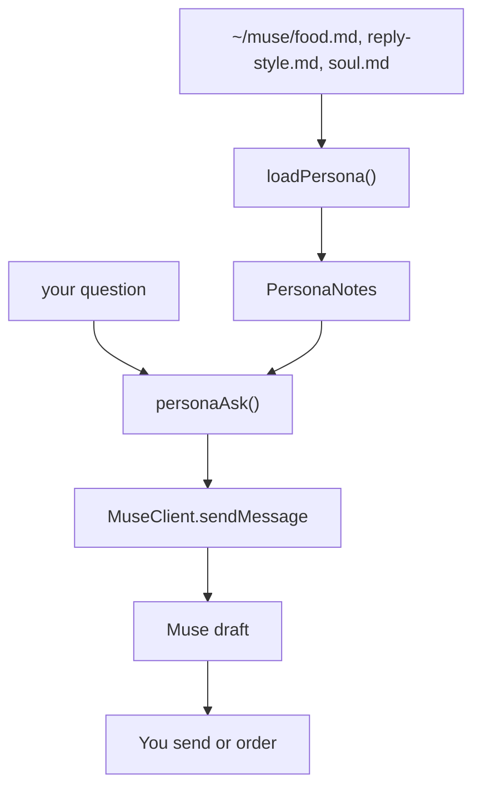

# Persona notes

Moved into the [README](../README.md#persona-notes). The diagrams stay in `docs/images/`.

This change lets this Mac attach your own notes to one Muse chat message. Muse drafts. You still send the text or place the order.

It does not add a gadget command channel. `MuseClient` still only chats.

## Flow




## Message shape


`personaAsk` builds one string, in this order:

1. The draft rule: never send, order, or spend money. One recommendation unless you ask for options.
2. `## food.md` and its text.
3. `## reply-style.md` and its text.
4. `## soul.md` and its text.
5. Your question, trimmed, last.

No other file is read. A `path` argument is not part of the API.

## Boundary


| Does | Does not |
| --- | --- |
| Read the three named files | Place an order |
| Fill a missing file with a placeholder | Send a chat for you |
| Cap each file at 24,576 characters | Read clipboard, history, or other paths |
| Attach the notes to one `send` | Speak on a gadget, or use a laptop VPN for a board |

Paste `soul.md` into the Muse app under the assistant icon, then Identity, then Soul, if the phone should follow the same rules. Do not replace that file. Append a section.

## Files

| File | Role |
| --- | --- |
| `src/persona.ts` | `loadPersona`, `personaAsk`, names, cap, placeholders |
| `examples/cli.ts` | `persona` and `send --persona` |
| `tests/persona.test.ts` | Notes load, other paths stay out, question stays last |
| `src/index.ts` | Re-exports `loadPersona` and `personaAsk` |

`loadPersona(root?)` defaults to `~/muse`. On a missing or unreadable file it records the name in `missing` and uses the placeholder. On a long file it records the name in `truncated` and keeps the first 24,576 characters.

## Use it

Fill the notes:

```sh
mkdir -p ~/muse
# edit ~/muse/food.md, reply-style.md, and soul.md
```

From this repository, after pairing:

```sh
bun run cli persona
bun run cli send --persona "what should I eat"
bun run cli send --persona "draft a reply to: running 10 min late"
```

`persona` prints the rule, names any missing files, then prints the three notes. It does not contact Muse.

`send --persona` contacts Muse. Without `--persona`, `send` is unchanged.

From code:

```ts
import { loadPersona, personaAsk, MuseClient } from 'muse-client';

const notes = await loadPersona();
const message = personaAsk(notes, 'what should I eat');
await client.sendMessage(message);
```

## Check

```sh
npm test -- tests/persona.test.ts
```

The test writes `food.md` and a decoy file, then checks that only the named notes appear and the question is last.
